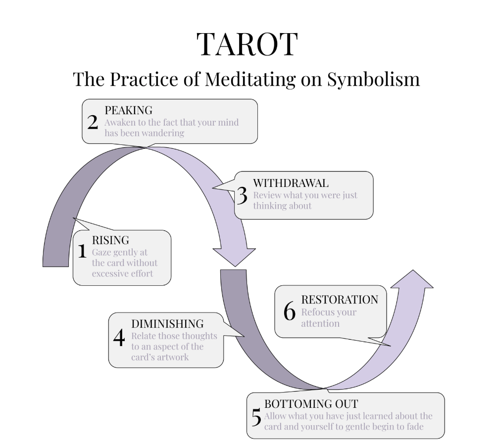

## The Practice of Purple: A Daily Tarot Draw

The Practice of Purple is a daily meditation on symbolism, most often expressed through the Tarot. Each morning (or whenever you feel called), you’re invited to draw a card from the Major Arcana and sit with it for five minutes, allowing its imagery, archetypal tone, and symbolic resonance to steep into your consciousness like tea leaves unfurling in hot water.

The recommended pattern—offered, not mandated—is to work through the 22 cards of the Major Arcana in sequence, one per day.
You begin with The Fool on Day 1 of this Stage and conclude with The World on Day 22, the first day of Red. This gives you a structured encounter with the Fool’s Journey: the arc of psychic evolution encoded in Tarot lore. But if a random draw feels more alive for you, follow that feeling. If you prefer Bibliomancy, the I Ching, Runes, or simply sitting with a symbol you encountered on your morning walk, beautiful.
This is your journey.

What matters most is how you engage the symbol. The image in this section illustrates the Wavelength of Purple Practice—not just the what, but the how. The five minutes trace the same six phases you’re learning to Inhabit, each in its Purple medicine: Inspiration, Joy, Introspectivity, Tranquility, Convalescence, Recuperation. Here’s how it flows:

**Rising — Inspiration.** Turn the card over and let it lift you. Don’t decode; receive. Something in the image will reach for you first—a color, a gesture, a figure’s gaze—and the first flicker of *oh* is the whole of this phase. Let yourself be guided by that nudge the way you’d follow a scent on a walk, without reaching for the card, and without needing the pull to mean anything yet.

**Peaking — Joy.** Let the feeling bloom in response to the card. Whatever it is—delight, unease, grief, wonder—let it arrive in full and in the body: the warmth, the clench, the leaning-toward or pulling-back. This is the sacral center answering, and it’s the crescendo of the practice. Savor it without grasping. Joy in Purple’s dosage is clean and present; the overdose is chasing it, so feel it fully and let it move.

**Withdrawal — Introspectivity.** At some point the feeling crests and your mind wanders. That’s the turn, not a failure. When you notice—“Oh, I’ve been thinking”—look at where you went. Was it a memory? An anxiety? A hope? The card stirred something and the mind went to find it. This is the quiet inner reflection Purple prescribes for the first decline: not more feeling, but a gentle noticing of what the feeling dredged up.

**Diminishing — Tranquility.** Now let the thought and the image sit together, without commentary. Is there a thread between what you drifted to and what’s on the card? Maybe. Don’t reason it out; let it be felt or not felt. The energy is settling here, and the medicine is softness: a retreat into comfort with whatever you found, the way you’d set down a book you’ve finished and just look out the window for a minute.

**Bottoming Out — Convalescence.** Let it all go quiet. The card, the feeling, the memory, the thread—let them fade without clutching, the meanings turning to mist. Empty hands, open palms. This is the compost heap of the practice, the restful emptiness that isn’t a problem to fix. If you feel nothing at all here, good; that’s the baseline you’re returning to.

**Restoration — Recuperation.** Energy stirs. Take one last look at the card’s image and feel your attention gather back toward the day. Then, if you wish, look up the traditional interpretation. Notice: do the meanings overlap with what you received? Conflict? Is there a nuance you missed? This isn’t confirmation; it’s curiosity, the first glimmer of meaning returning—and then you rejoin the world with it, rather than hoarding it.

This practice isn’t about being “right.” It’s not about mastering esoteric knowledge or performing spiritual correctness.
It’s about cultivating the subtle art of receptivity—learning to listen symbolically, emotionally, somatically. To let meaning emerge rather than impose it.

And crucially: this is not the only way. APTITUDE is a map, not a prescription. You are not being led—you are choosing to walk. I am not your guru. You are your own guide. Tarot is just one trailhead into the forest of archetype, intuition, and mythic resonance.
There are others. Many others. We’ll explore more later.

But for now, try this: one card. Five minutes. A gentle wave of attention. A soft Yes to the sacred.

It’s amazing what can be revealed in the space you’re willing to receive.
